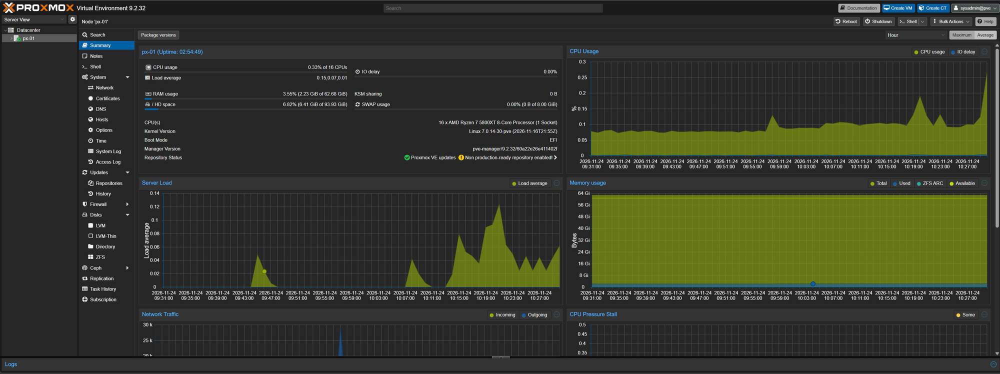
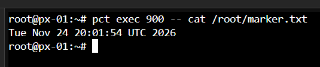
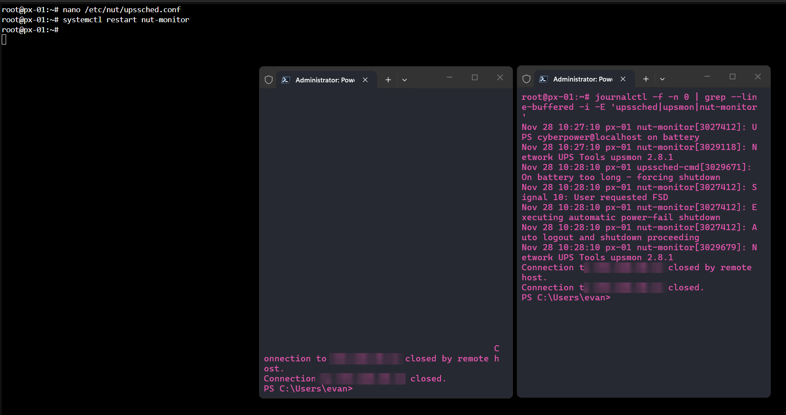
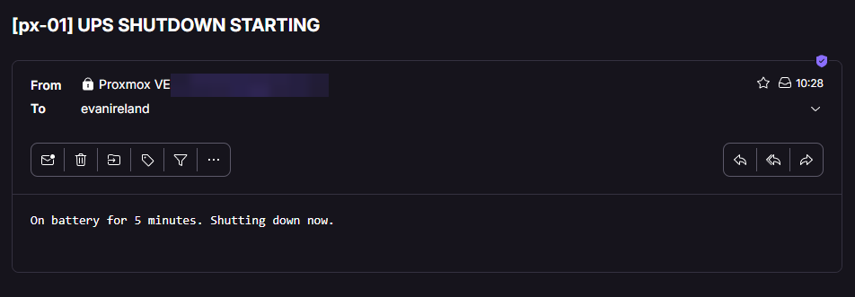
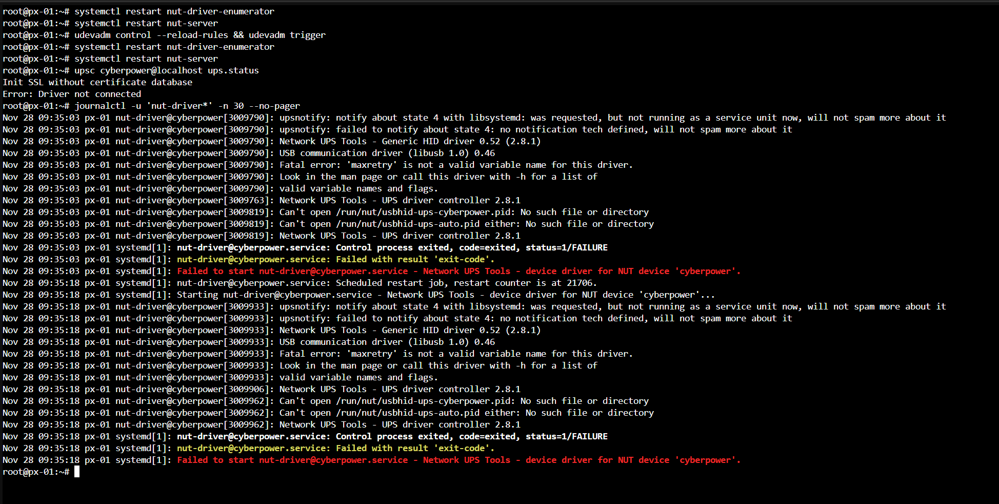

A UPS - uninterruptible power supply - is a battery box that sits between the wall and your
computer and keeps the power on when the house loses it. What most people miss is that a UPS does
not shut anything down. It buys minutes. Unless software
watches the battery and tells the computer to shut down cleanly, the computer runs until the
battery is empty and then loses power anyway - the exact outcome the UPS was bought to prevent.
Network UPS Tools ([networkupstools.org](https://networkupstools.org/)) is the software that closes
that gap on Linux, and getting it right turned out to be the most educational part of this whole
project.

Cards on the table before going any further: Claude (Anthropic's AI) wrote the build guide I worked
from, and Claude kept the build log while I did the work. I did every step on the actual hardware,
checked every result, and caught a fair number of the mistakes - in the guide, in Claude's
expectations, and in my own typing. The honest accounting is further down, with numbers.

## How I got here

Back in August I built a three-node Proxmox cluster in the basement: two used HP office desktops and
a Ryzen machine built from parts around the house. The full writeup is
[here](/projects/proxmox-cluster/). It worked, and it taught me a lot. It also taught me that two
older HP business desktops will fight you on every boot-order and BIOS change, every single time.
Honestly, I just did NOT have the time nor the patience to deal with that headache all the time so I said screw it, one box it is.

So in October I scrapped it. One machine, the Ryzen box, became the only server, renamed `px-01`.
The HP desktops got gutted for parts. Then I took about a month off from the homelab while life
happened, and came back to it with a long written guide and a rule: every step gets checked against an
expected result, with a screenshot, before the next step starts.

## One box, one failure domain

A cluster is several computers that act like one, so a single machine can die without taking
everything down. That is a great property to have, and it costs a lot - at least two machines that
boot reliably, quorum, a lot of moving parts. I had one machine that booted reliably.

Going down to one host gets rid of every cluster failure mode at once. The trade-off is just as
real, and is incredibly obvious: **one host is one failure domain.** A dead power supply, ransomware, a fire, or a burglar takes the services
and the backups together. Until I have a backup copy that is not plugged into the same box, the
backups protect against my own mistakes and dead disks, and not against a bad day.

Yes I'm aware this is less than ideal, but I'm rolling with it for now. 

## What I built

- **Three disks, three jobs.** A 1 TB NVMe for Proxmox and every virtual machine, a 2 TB WD Red NVMe
  handed whole to the backup server, and a 1 TB SATA SSD set aside for NAS data. The bigger disk
  holds the backups because a backup disk has to be bigger than what it protects.
- **Proxmox Backup Server in a virtual machine,** backing up everything else at 2 AM, with pruning,
  cleanup and weekly verification scheduled behind it.
- **A backup account that can add backups but cannot delete them.** If the main host ever gets
  compromised, whatever lands on it cannot use that account to wipe the backup history.
- **Email alerts through a dedicated Gmail account,** sent only when something goes wrong.
- **The UPS,** with Network UPS Tools set to shut the server down after five minutes on battery.

The full configuration, with tables, is on the [project page](/projects/px-01-home-server/).

*px-01's summary page: Proxmox VE 9.2, 16 threads, 64 GB.*

## The part where I tried to break it

A backup you have never restored is a hope, not a backup. So I made a throwaway container, wrote the
current time into a file inside it, backed it up, and then destroyed the container completely. The
only copy left was the backup. I restored it, read the file back, and got the same timestamp to
the second. Then I shut the backup server off on purpose and ran the backup job, to make sure the
failure email actually showed up. It did.

*Same timestamp after destroy and restore.*

The UPS got the same treatment: a check that the alerts work, then the two power tests from the
guide (it calls them rungs, as in a ladder you climb one step at a time):

- **Alert check.** Fake a lost connection to the UPS, and make sure the alert email arrives without
  me running anything by hand.
- **Rung 1, a brief outage.** Pull the UPS's plug out of the wall for about 50 seconds, then put it
  back. The server should switch to battery, email me, cancel its shutdown timer when power returns,
  and email me again.
- **Rung 2, a full outage.** Pull the plug and leave it out, with the timer cut to 60 seconds for
  the test. The server should shut down cleanly, the UPS should cut its own power afterwards, and
  when I plug it back in the server should turn itself on and start its virtual machines with
  nobody touching it.

All three passed. On the full outage, the shutdown started 60 seconds after I pulled the plug, the
backup server shut down cleanly in 3 seconds, and the UPS went dark about three minutes in. Less
than two minutes after I plugged it back in, the server was up with its virtual machine running.

*60 seconds on battery, then a forced shutdown.*

*The email that arrives before the lights go out.*

## Five ways it would have failed, and none of them would have told me

This is the section that justifies the whole "check every step" rule. Before any of those tests
could pass, I found five problems in the UPS setup, and every one of them failed **silently** -
no error on screen, no email, nothing until the night the power actually went out:

- **A typo in the UPS's product ID** (`0641` instead of `0601`). The driver would have looked for a
  UPS that does not exist.
- **A setting in the wrong place in the config file.** I added my UPS section above a line the
  package already had, so the driver read that line as its own setting and refused to start. It had
  been quietly failing and restarting every 15 seconds for four days - 21,706 times - while
  everything else looked fine.
- **A space in the alert script** (`early shutdown` instead of `earlyshutdown`). That one space was a
  syntax error that broke every single UPS alert, not just the shutdown.
- **`/user/` instead of `/usr/`** in the shutdown command. The alerts would have arrived, and the
  shutdown never would have happened.
- **`COMMMBAD` with three M's.** No error at all - it just matched nothing, so that alert could never
  fire.

Four of those five were my own typos. The fifth was a gap in the guide.

Hey man, I work in IT not at the Spelling Bee alright. 

*21,706 silent restarts.*

## The honest accounting

Since I said there would be numbers:

- **The guide got corrected in place approximately twenty times** during the build. Some were
  rendering problems - the PDF printed two commands on one line in five places, which is how
  `pct stop 900 pct destroy 900` ended up in my terminal. Some were steps that were missing
  outright: the backup server had never actually updated its own software, because the guide
  buried the repository change in one sentence and I skipped right past it.
- **Claude's "expected result" was wrong several times.** It told me a blocked root login would not
  show a password prompt (it does), that a log would contain a line that never appears, and that a
  setting needed changing when Proxmox simply does not write default values to its config files.
  Each time, the real output on my screen won, and the guide got fixed.
- **I made five typos that mattered**, listed above, plus one harmless one (`scsil` for `scsi1` - in
  the PDF's font, the letter L and the number one look nearly identical).

Every correction is in the build log with a timestamp and a screenshot. That log is the actual
product here, more than the server.

## Why "check every step" matters

Think about the smoke detector in your hallway. It sits there for years doing nothing you can see,
and the only moment it matters is the one moment you cannot afford for it to fail. That is why the
little test button exists - you do not find out whether it works by waiting for a fire. A UPS
shutdown setup is exactly that kind of system. Every piece of it can be broken while the server
runs perfectly, every day, for months, and you only find out during the outage it was built for.
The only way to know is to press the test button yourself: pull the plug on purpose, on a quiet
afternoon, and watch.

Simply put: if the only time a system runs is during an emergency, test it before the emergency
does.

## What's next

Much like every other homelabber - the fun just never stops, and neither does the cash flowing from my bank account apparently. 

The server works, the backups restore, and the power can go out without me lying awake about it.
What it does not do yet is anything the rest of the house would notice. Next up are Pi-hole and
unbound for the house's DNS, then monitoring and a NAS - and a second backup copy that does not live
in the same box. I'm sure I'll get around to it eventually.

Thank you for reading! - Evan

The full build guide, corrections included, is a [free PDF download](/assets/docs/proxmox-home-server-build-guide-v3.0.pdf).

*Build guide and build log written with Claude (Anthropic). Every step executed and verified by me.*
