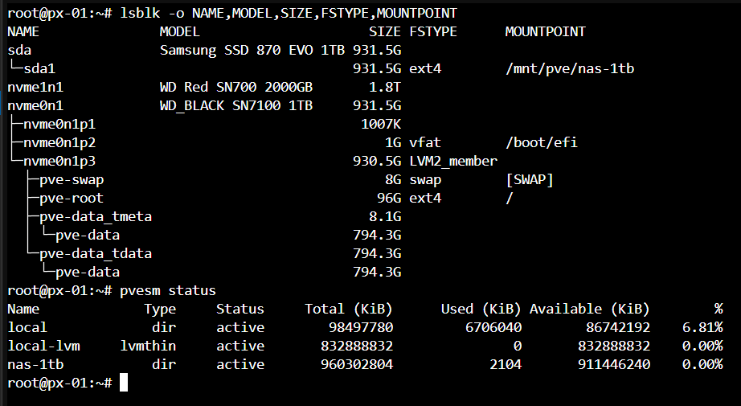
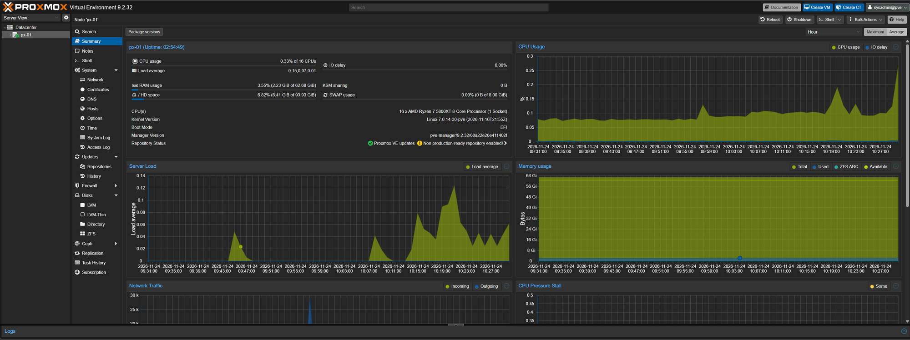
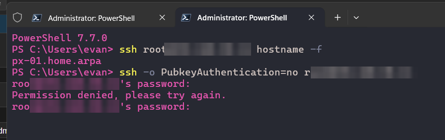
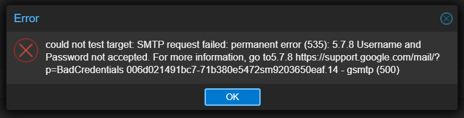
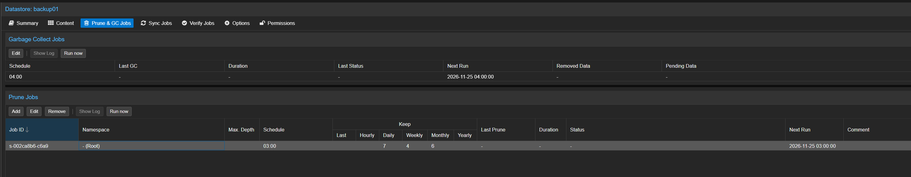
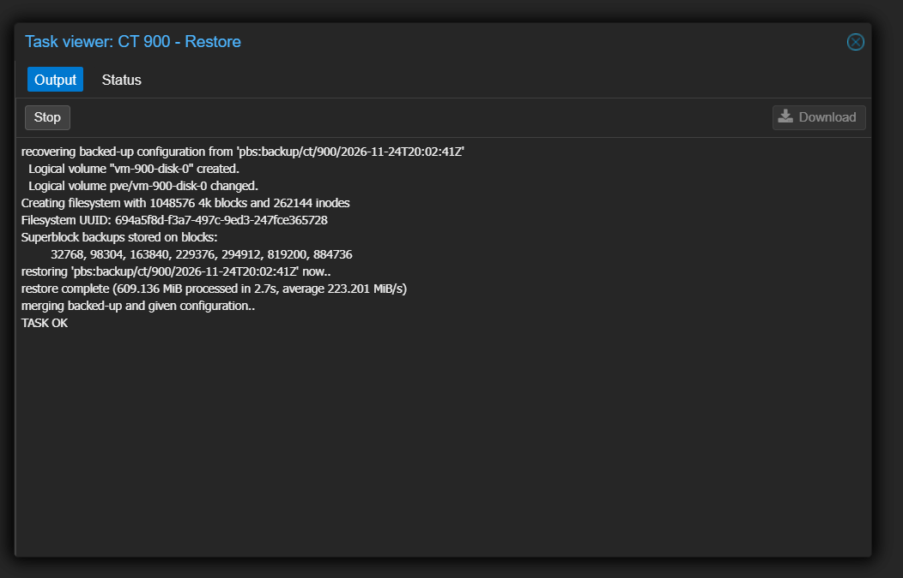
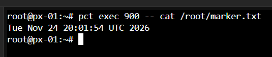
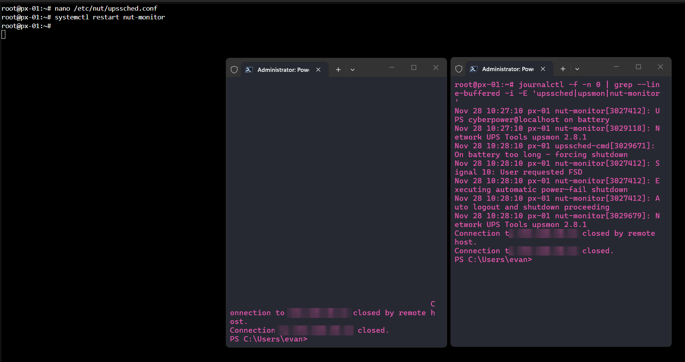
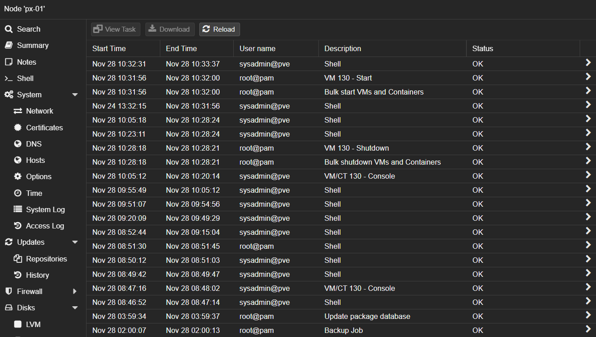
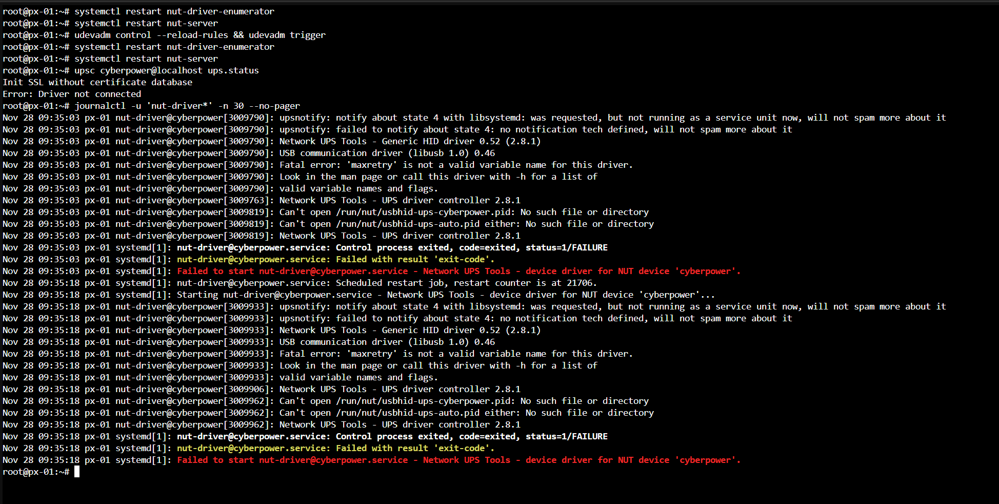

**Project.** One always-on Proxmox VE host running household services and a rehearsal lab, with a
dedicated backup server, a proven restore, and UPS-driven shutdown and recovery.

**Status:** in service. Built 23-28 November 2026. Replaces the
[three-node cluster](/projects/proxmox-cluster/) built in August 2026.

**Build guide:** [Proxmox Home Server Build Guide v3.0 (PDF, 46 pages)](/assets/docs/proxmox-home-server-build-guide-v3.0.pdf) - the full
procedure this build followed: every command, its expected result and the reason for it, with the
corrections the build forced listed in an appendix.

---

In August I built a three-node Proxmox cluster out of two used office desktops and a machine I put
together from spare parts. It worked. It also spent the next two months reminding me that two of
those three nodes were old HP business desktops with opinions about booting.

In October I scrapped it. The Ryzen machine became the only server, the HP desktops got gutted for
parts, and the whole thing got rebuilt from a written guide - this time with every step checked
against an expected result before moving to the next one. The narrative version, including the five
UPS configuration mistakes that would each have failed silently in a real outage, is in the
[companion post](/posts/px-01-home-server/). This page is the technical record.

## Why One Host

The cluster solved problems this household does not have. Quorum, live migration and high
availability need at least two machines that boot reliably; two of the three did not. A single host
removes every cluster failure mode.

The trade is stated plainly: **one host is one failure domain.** A failed power supply, ransomware
on the host, a fire or a theft takes the services and the backup disk at the same moment. Until a
copy exists that is not plugged in, the backups protect against deleted guests, bad upgrades and
disk failure, and nothing worse.

## Hardware

| Component | Specification |
|---|---|
| Board | ASUS Prime B550M-A WiFi II |
| Processor | AMD Ryzen 7 5800XT, 8 cores / 16 threads |
| Memory | 64 GB DDR4, run at JEDEC 2133 MT/s |
| Graphics | GeForce GTX 1050 Ti - kept until a headless boot has been tested |
| UPS | CyberPower CP1500PFCLCD, pure sine wave, USB to the host |

### One Disk, One Job

| Disk | Slot | Job | Proxmox storage |
|---|---|---|---|
| WD_BLACK SN7100 1 TB NVMe | M.2_1, PCIe 4.0 | Proxmox VE and every guest disk | `local`, `local-lvm` (794 GB thin pool) |
| WD Red SN700 2 TB NVMe | M.2_2, PCIe 3.0 | Backup datastore, passed whole to the backup VM | None on the host |
| Samsung 870 EVO 1 TB SATA | SATA | NAS data | `nas-1tb` (directory, ext4) |

The 2 TB drive holds backups rather than NAS data because a backup target must be larger than what
it protects: up to 1 TB of guests plus up to 1 TB of NAS data. Reversed, a 2 TB NAS would back up
onto 1 TB and fail the night it filled. The SN700's high write endurance also suits the
write-heavy job - nightly chunks, garbage collection and verification - better than a NAS that is
mostly written once and read many times.

ZFS was not used. No disk is mirrored, so ZFS could detect corruption but not repair it; the backup
server's own checksums and weekly verification cover the data that matters.

*Three disks, three jobs. The SN700 has no host storage by design.*

## Architecture

| Guest | ID | Role | State |
|---|---|---|---|
| pbs | VM 130 | Proxmox Backup Server 4.2 | Running |
| pihole | CT 131 | DNS filtering | Planned |
| unbound | CT 132 | Recursive DNS | Planned |
| monitor | CT 133 | Monitoring | Planned |
| nas | CT/VM 134 | File shares | Planned |

The guests share the host's server network. The planned lab gets its own internal bridge behind
an OPNsense gateway, so lab traffic never touches the household network.

*px-01's summary page: Proxmox VE 9.2, 16 threads, 64 GB.*

## Access

- Daily administration uses `sysadmin@pve` with the Administrator role and TOTP. `root@pam` has no
  second factor by design: a lost phone must not lock the owner out of the hypervisor.
- Root logs in over SSH by key only (`PermitRootLogin prohibit-password`). A root password prompt
  still appears, and the correct password is refused - OpenSSH does not say why.
- The enterprise repositories are disabled on both systems and the No-Subscription repositories
  enabled. The backup server is a separate Proxmox product with its own repository; it needs the
  same change made separately.

*Key login works; the correct root password is refused.*

## Alerts

Both systems send mail through a dedicated Gmail account using an app password, one per system.
Residential connections commonly block outbound port 25, so the default local mail path never
reliably delivered. A matcher sends **error, warning and unknown** events only; a successful backup
is severity `info` and is deliberately silent. Mail sent to root by system tools, including the UPS
scripts, arrives as `unknown`.

*Google rejecting the credential, not the server settings.*

`535 5.7.8` means Google rejected the credential, not the server settings. Here the cause was a
two-step verification method added to the account without two-step verification being switched on,
which also hides the App passwords page.

## Backup

| Item | Configuration |
|---|---|
| Server | Proxmox Backup Server in VM 130; the SN700 passed through by its `/dev/disk/by-id/` name |
| Job | Nightly 02:00, every guest except VM 130, snapshot mode |
| Credential | `pve-backup@pbs`, role `DatastoreBackup` - it can add backups and cannot delete them |
| Prune | 03:00 - keep 7 daily, 4 weekly, 6 monthly |
| Garbage collection | 04:00 |
| Verification | Sunday 05:00 - skip verified, re-verify after 30 days |

Retention is enforced on the backup server, not by the host. A credential on the host that cannot
prune is one that ransomware on the host cannot use to destroy backup history.

*Prune at 03:00, garbage collection at 04:00.*

### Restore Drill

A disposable container (CT 900) received a marker file holding a timestamp, was backed up, and was
destroyed. The only remaining copy was the backup. It was restored from the backup server and the
marker read back.

| Step | Result |
|---|---|
| Marker written | `Tue Nov 24 20:01:54 UTC 2026` |
| Restore | 609 MiB in 2.7 s, `TASK OK` |
| Marker after restore | `Tue Nov 24 20:01:54 UTC 2026` - match |
| Backup server stopped, job run | Failure email received |

*609 MiB restored in 2.7 seconds.*

*Same timestamp after destroy and restore.*

## Power Protection

NUT (Network UPS Tools) runs in standalone mode on the host: the USB driver, the data server on the
loopback address only, and the monitor. **Shutdown is on a timer, not at low battery** - 300 seconds
on battery starts a forced shutdown, so short outages ride through and long ones shut down with
most of the battery in reserve. The firmware's **Restore AC Power Loss = Power On** setting brings
the host back when mains returns.

| Measurement | Value |
|---|---|
| Load | ~6% of rating |
| Estimated runtime | 5,900 s (~98 min) |
| Shutdown timer | 300 s (60 s for the test) |

### Test Ladder

A check of the alert chain first, then the guide's two-rung power test.

| Rung | Test | Result |
|---|---|---|
| Check | Alert chain: a forced communication loss | Email from upsmon -> upssched -> script -> mail -> matcher -> Gmail |
| 1 | 50 s on battery, then mains restored | ON BATTERY and back-on-mains emails; timer cancelled; nothing shut down |
| 2 | Full outage, plug left out | Timer fired at T0 + 60 s; VM 130 shut down cleanly in 3 s; host halted; UPS cut its output; mains restored; host powered on unattended; VM 130 started itself |

*60 seconds on battery, then a forced shutdown.*

*Clean shutdown, then unattended start.*

### Faults Found Before the Power Was Pulled

Each of these would have failed silently during a real outage.

| Fault | Effect | Fix |
|---|---|---|
| `productid = 0641` typed for `0601` | Driver finds no UPS | IDs copied from `nut-scanner` output |
| UPS block placed above the packaged global `maxretry = 3` | Driver read `maxretry` as its own setting and refused to start - 21,706 automatic restarts over four days | Globals moved above the first `[section]` |
| `early shutdown)` with a space in the alert script | Shell syntax error - every UPS alert broken | `earlyshutdown)`, checked with `sh -n` |
| `/user/sbin/upsmon` in the shutdown command | Forced shutdown would never run | `/usr/sbin/upsmon` |
| `AT COMMMBAD` in `upssched.conf` | Matched no event; that alert never fired | `AT COMMBAD` |

*21,706 silent restarts.*

## Limits

- **No removable or off-site copy.** A 3 TB drive is set aside for a removable datastore; the USB
  dock is not on hand.
- **The backup server itself is not backed up.** Its configuration is archived off the box.
- **UPS emails cannot leave the house during a whole-house outage** - the modem, firewall and
  powerline adapters are not on the UPS.
- **A nightly backup of a real guest is unproven** until the first service exists.

## Outcome

The server does less than the cluster did on paper, and more in practice. Pull the plug and it
shuts itself down, cuts the power, and comes back on its own when the power returns - I watched it
do exactly that. And the backups have been restored, not just taken.

Next up are the services that justify having a server at all: Pi-hole and unbound for the house's
DNS, then monitoring and the NAS. Plus whatever else my little heart desires. 

*Build guide written with Claude (Anthropic); every step executed, evidenced and corrected by me.
[Download the guide (PDF)](/assets/docs/proxmox-home-server-build-guide-v3.0.pdf).*
